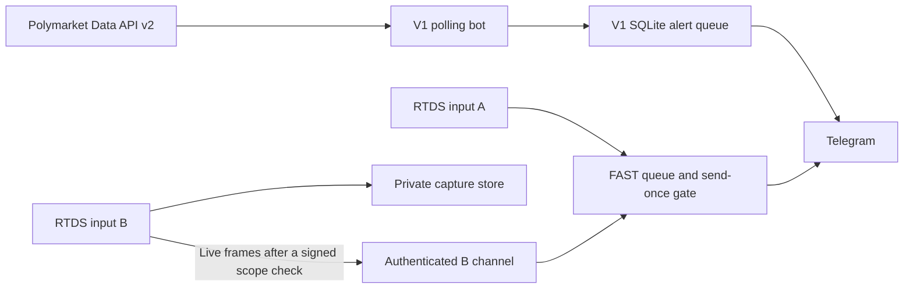

# Architecture

## Components

- V1 lives in [src](../src). The activity client uses the endpoint and cursor format in the [Polymarket Data API v2 migration guide](https://docs.polymarket.com/migrate/data-api-v1-to-v2). Tests cover rate limits, subscriptions, checkpoints and delivery queue recovery.
- [FAST](../components/holy-snipe-fast) handles live RTDS trades. Its [receive workers and delivery gates](../components/snipe-rtds-resilient) limit buffered frames and fence stale delivery claims. [Bridge modules](../components/snipe-v3-combined) give both inputs one writer.
- [The B candidate](../components/snipe-b-receiver) saves eligible events on disk before forwarding. During a channel loss it uses the last known wallet scope for capture. This scope can become outdated while offline. It verifies a signed scope update before resuming live forwarding. Outage events and frames with uncertain queue acknowledgments stay available for reconciliation.
- [The V2 menu runtime](../components/snipe-v2-runtime/src) is included as JavaScript because FAST uses its menu, profile resolver and subscription repository.

The component suite covers bursts, lost channel acknowledgments, queue and state deadlines, duplicate A/B data, and TLS failures. It uses local sockets or simulated network responses. The B capture behavior has been exercised on a local copy. Operational state, historical deliveries and deployment settings are managed separately.
